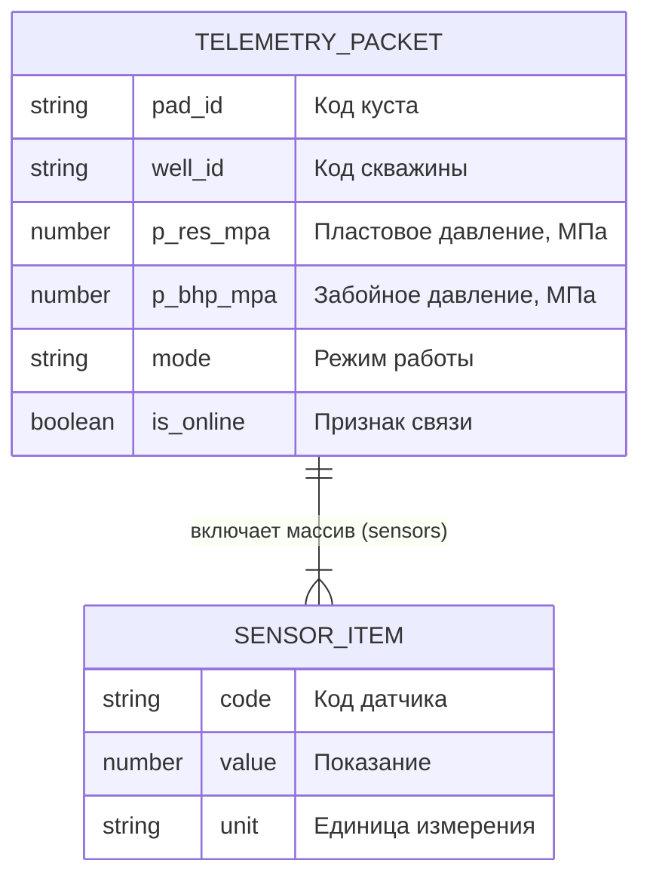

# Практическая работа № 2
## Тема: «Проектирование структур данных предметной области: схема сущностей, полей и формат обмена данными (JSON и JSON-Schema)»

* **Дисциплина:** Программирование и прототипирование ИТ-решений
* **Направление подготовки:** 09.03.03 Прикладная информатика (профиль «Бизнес и системная аналитика»)
* **Студент:** Мусин Тимур Булатович (совмещение ролей Системного аналитика и Разработчика)
* **Репозиторий:** [https://github.com/legionhaos/prac2-json-contract](https://github.com/legionhaos/prac2-json-contract)
* **Траектория:** Вариант Б (Продвинутый) — *«Пакет телеметрии куста скважин с массивом датчиков»*

---

## 1. Индивидуальный расчет параметров

Индивидуальное число студента: **$N = 69$** (по номеру зачётки).

* $\text{pad\_id} = \text{"PAD-"} + (10 + (69 \pmod{20})) = \text{"PAD-"} + (10 + 9) =$ **`"PAD-19"`**
* $\text{well\_id} = \text{"W-"} + (200 + 69) =$ **`"W-269"`**
* $p\_res\_mpa = 22.0 + 0.5 \times (69 \pmod{20}) = 22.0 + 0.5 \times 9 =$ **`26.5`** МПа
* $p\_bhp\_mpa = 12.0 + 0.4 \times (69 \pmod{20}) = 12.0 + 0.4 \times 9 =$ **`15.6`** МПа
* $temp\_c = 45.0 + 1.5 \times (69 \pmod{15}) = 45.0 + 1.5 \times 9 =$ **`58.5`** °C (датчик `T-01`)
* $rate\_m3d = 60.0 + 4.0 \times (69 \pmod{25}) = 60.0 + 4.0 \times 19 =$ **`136.0`** м³/сут (датчик `Q-01`)
* $\text{mode} =$ **`"PUMPING"`**
* **Челлендж № 1:** добавлено булево поле $\text{is\_online} = \text{True}$ и третий датчик устьевого давления `P-01` ($14.0$ МПа).

---

## 2. Словарь данных (Data Dictionary)

| Поле (путь JSON) | Описание смысла поля | Тип Python | Тип JSON | Обяз.? | Значение студента (N=69) |
| :--- | :--- | :--- | :--- | :---: | :--- |
| `pad_id` | Номер кустовой площадки | `str` | `string` | Да | `"PAD-19"` |
| `well_id` | Код скважины | `str` | `string` | Да | `"W-269"` |
| `p_res_mpa` | Пластовое давление, МПа | `float` | `number` | Да | `26.5` |
| `p_bhp_mpa` | Забойное давление, МПа | `float` | `number` | Да | `15.6` |
| `mode` | Режим эксплуатации скважины | `str` | `string` | Да | `"PUMPING"` |
| `is_online` | Признак связи со станцией (Челлендж 1) | `bool` | `boolean` | Да | `true` |
| `sensors` | Список замеров с датчиков | `list[dict]` | `array` | Да | `[{...}, {...}, {...}]` |
| `sensors[].code` | Код датчика в массиве | `str` | `string` | Да | `"T-01"`, `"Q-01"`, `"P-01"` |
| `sensors[].value` | Измеренное показание датчика | `float` | `number` | Да | `58.5`, `136.0`, `14.0` |
| `sensors[].unit` | Единица измерения датчика | `str` | `string` | Да | `"C"`, `"m3/d"`, `"MPa"` |

---

## 3. ER-диаграмма сущностей (Mermaid)

---

## 4. Спецификация контракта данных (JSON-Schema)

Контракт формализован в файле `schema.json` согласно стандарту `Draft 2020-12`.

Ключевые правила валидации:
1. Обязательные поля: `pad_id`, `well_id`, `p_res_mpa`, `p_bhp_mpa`, `mode`, `is_online`, `sensors`.
2. Граничные условия давлений:
   * $p\_res\_mpa \in [5.0; 60.0]$ МПа
   * $p\_bhp\_mpa \in [1.0; 60.0]$ МПа
3. Перечисление (enum) режимов работы: `'FLOWING'`, `'PUMPING'`, `'SHUT_IN'`.
4. Физическое перекрёстное правило: при `mode == "PUMPING"` забойное давление $P_{заб}$ не может превышать пластовое $P_{пл}$.
5. Массив `sensors`: минимум 2 объекта, обязательные атрибуты `code`, `value`, `unit`, где `unit` строго из `['MPa', 'C', 'm3/d']`.

---

## 5. Результаты прогона валидатора (Таблица сверки)

| Тестовый сценарий (Этап 2) | Ожидание по `schema.json` | Фактический ответ `validator.py` | Совпало? |
| :--- | :--- | :--- | :---: |
| **Сценарий 1:** Эталонный файл `data.json` | VALID (0 ошибок) | `[Сценарий 1] Эталонный файл data.json -> УСПЕШНО (VALID)` | **Да** |
| **Сценарий 2:** Выход за границы / неверный enum | ОТКЛОНЕНО (2 ошибки) | `x Режим mode='OVERDRIVE' не входит в enum ['FLOWING', 'PUMPING', 'SHUT_IN']` `x Датчик #0: единица 'psi' не входит в enum ['MPa', 'C', 'm3/d']` | **Да** |
| **Сценарий 3:** Потеря обязательного поля / minItems | ОТКЛОНЕНО (1 ошибка) | `x Массив 'sensors' должен содержать минимум 2 датчика` | **Да** |
| **Сценарий 4:** Физическое противоречие давлений при PUMPING | ОТКЛОНЕНО (1 ошибка) | `x Физическое противоречие: при режиме PUMPING Pзаб > Pпл!` | **Да** |
| **Сценарий 5:** Челлендж № 2 («Диверсия в broken_data.json») | ОТКЛОНЕНО (2 ошибки) | `x Режим mode='TURBO' не входит в enum ['FLOWING', 'PUMPING', 'SHUT_IN']` `x Датчик #0: единица 'Kelvin' не входит в enum ['MPa', 'C', 'm3/d']` | **Да** |

---

## 6. Ответы на контрольные вопросы для защиты

### Этап 1: Моделирование и JSON
* **Вопрос 1.1:** *Почему передавать карточку скважины в виде единого словаря `dict` удобнее и надёжнее, чем передавать в функцию 8 отдельных переменных через запятую?*
  * **Ответ:** Передача единого словаря (или объекта) обеспечивает инкапсуляцию и снижает связанность кода. При изменении или расширении состава атрибутов не требуется менять сигнатуру функций по всему проекту. Исключается риск перепутать порядок позиционных аргументов одинакового типа (например, числовые показатели давления или дебита), а структура данных может быть напрямую сериализована и передана по API без промежуточных преобразований.
* **Вопрос 1.2:** *Назовите минимум 3 отличия синтаксиса файла `data.json` от словаря `dict` в Python. Зачем в функции `json.dump()` нужен параметр `ensure_ascii=False`?*
  * **Ответ:**
    1. Ключи в JSON обязаны быть строками в двойных кавычках `"key"`, тогда как в Python ключами словаря могут быть одинарные кавычки, числа, кортежи и другие неизменяемые объекты.
    2. Булевы литералы и null: в JSON используются строчные `true`, `false`, `null`, а в Python — `True`, `False`, `None`.
    3. В JSON запрещены висячие запятые (trailing commas) после последнего элемента массива или объекта, а также строковые комментарии (`#`).
    *Параметр `ensure_ascii=False`* указывает сериализатору сохранять символы не-ASCII (включая кириллицу) в читаемом виде UTF-8, а не экранировать их в Unicode-последовательности вида `\u041f\u0440\u0438`.

### Этап 2: Контракт данных и JSON-Schema
* **Вопрос 2.1:** *Что такое контракт данных (JSON-Schema) и за что отвечают ключевые слова `required`, `properties`, `minimum`/`maximum` и `enum` в файле `schema.json`?*
  * **Ответ:**
    * *Контракт данных* — декларативная спецификация, формализующая структуру, типы и семантические ограничения на передаваемые данные.
    * `required` — массив названий ключей, присутствие которых в объекте строго обязательно.
    * `properties` — словарь, описывающий схему и ограничения для каждого конкретного поля объекта.
    * `minimum` / `maximum` — задают допустимый диапазон значений для числовых полей включительно.
    * `enum` — задаёт закрытый список (множество) допустимых значений, за пределы которого поле выходить не может.
* **Вопрос 2.2:** *Почему в функции валидации в Python мы пишем проверку `not isinstance(depth, bool)` после `isinstance(depth, int)`?*
  * **Ответ:** В языке Python тип `bool` является прямым подклассом типа `int` (`issubclass(bool, int) is True`), а значения `True` и `False` численно равны `1` и `0`. Если выполнить только проверку `isinstance(val, int)`, булево значение `True` вернёт `True` и будет ошибочно принято за валидное число. Дополнительное условие `not isinstance(..., bool)` гарантирует фильтрацию логических типов.
