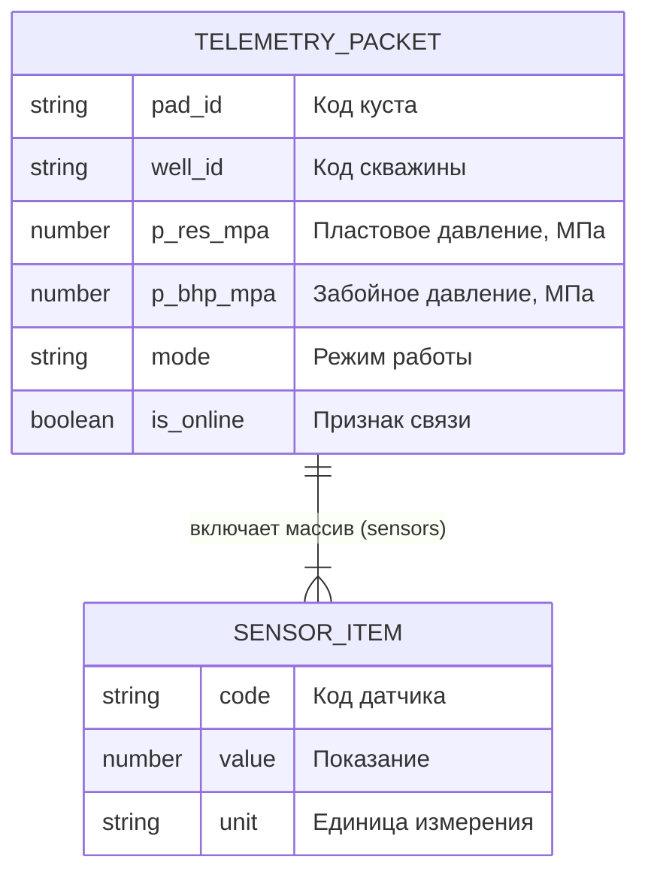

# ОТЧЁТ ПО ПРАКТИЧЕСКОЙ РАБОТЕ № 2

**Дисциплина:** Программирование и прототипирование ИТ-решений  
**Направление подготовки:** 09.03.03 Прикладная информатика (профиль «Бизнес и системная аналитика»)  
**Тема работы:** «Проектирование структур данных предметной области: схема сущностей, полей и формат обмена данными (JSON и JSON-Schema)»  
**Вариант траектории:** Вариант Б (Продвинутый) — *«Пакет телеметрии куста скважин с массивом датчиков»*  

---

## ТИТУЛЬНЫЙ БЛОК

* **Студент:** Мусин Тимур Булатович
* **Распределение ролей:**
  * **Этап 1 (Пара 1):** Системный аналитик (СА) / Разработчик (Dev) — Мусин Т.Б.
  * **Этап 2 (Пара 2):** Системный аналитик (СА) / Разработчик (Dev) — Мусин Т.Б.
* **Индивидуальный номер студента:** $N = 69$ (по номеру зачётки)
* **Ссылка на репозиторий GitHub:** [https://github.com/legionhaos/prac2-json-contract](https://github.com/legionhaos/prac2-json-contract)

---

## 1. ЦЕЛЬ РАБОТЫ И ПОСТАНОВКА ЗАДАЧИ

### 1.1. Цель работы
Освоить переход от разрозненных скалярных переменных к агрегированным структурированным моделям предметной области (вложенные словари Python), реализовать надёжную сериализацию и десериализацию данных в текстовом формате JSON, а также спроектировать декларативный контракт данных JSON-Schema с программным модулем валидации, отсекающим аномальные и «грязные» данные.

### 1.2. Легенда предметной области (Вариант Б)
Проектируется протокол сетевого обмена телеметрией между контроллером кустовой площадки и сервером АСУ ТП. Каждую минуту контроллер формирует JSON-пакет, содержащий:
* Идентификатор кустовой площадки (`pad_id`);
* Код скважины (`well_id`);
* Пластовое давление (`p_res_mpa`) в диапазоне $[5.0; 60.0]$ МПа;
* Забойное давление (`p_bhp_mpa`) в диапазоне $[1.0; 60.0]$ МПа;
* Режим работы скважины (`mode`): строго одно из значений `'FLOWING'`, `'PUMPING'`, `'SHUT_IN'`;
* Признак активности связи со станцией (`is_online`: булево значение, добавлено в Челлендже 1);
* Массив датчиков (`sensors`): список минимум из 2 объектов, каждый из которых содержит `code` (код датчика), `value` (показание) и `unit` (единицу измерения: `'MPa'`, `'C'`, `'m3/d'`).
* **Физическое ограничение предметной области:** при режиме `'PUMPING'` забойное давление $P_{заб}$ не может превышать пластовое $P_{пл}$.

---

## 2. ИНДИВИДУАЛЬНЫЙ РАСЧЁТ ПАРАМЕТРОВ (ДЛЯ N = 69)

Расчётные формулы Варианта Б:
```python
N = 69
pad_id    = f"PAD-{10 + (N % 20)}"          # 69 % 20 = 9  -> "PAD-19"
well_id   = f"W-{200 + N}"                  # 200 + 69     -> "W-269"
p_res_mpa = 22.0 + 0.5 * (N % 20)           # 22.0 + 4.5   -> 26.5 МПа
p_bhp_mpa = 12.0 + 0.4 * (N % 20)           # 12.0 + 3.6   -> 15.6 МПа
temp_c    = 45.0 + 1.5 * (N % 15)           # 45.0 + 13.5  -> 58.5 °C (T-01)
rate_m3d  = 60.0 + 4.0 * (N % 25)           # 60.0 + 76.0  -> 136.0 м3/сут (Q-01)
mode      = "PUMPING"
```

* **Депрессия на пласт:** $\Delta P = P_{пл} - P_{заб} = 26.5 - 15.6 = 10.90$ МПа.
* **Челлендж № 1:** в корень добавлено поле `"is_online": True`, в список датчиков добавлен 3-й датчик устьевого давления `P-01` со значением `14.0 MPa`.

---

## 3. РАЗДЕЛ ЭТАПА 1: МОДЕЛИРОВАНИЕ И ФАЙЛОВЫЙ ОБМЕН JSON

### 3.1. Таблица структуры данных (Data Dictionary)

| Поле (JSON) | Описание поля | Тип Python | Тип JSON | Обяз.? | Значение (N=69) |
| :--- | :--- | :--- | :--- | :---: | :--- |
| `pad_id` | Идентификатор кустовой площадки | `str` | `string` | Да | `"PAD-19"` |
| `well_id` | Уникальный код скважины | `str` | `string` | Да | `"W-269"` |
| `p_res_mpa` | Пластовое давление, МПа | `float` | `number` | Да | `26.5` |
| `p_bhp_mpa` | Забойное давление, МПа | `float` | `number` | Да | `15.6` |
| `mode` | Режим работы скважины | `str` | `string` | Да | `"PUMPING"` |
| `is_online` | Статус связи со станцией | `bool` | `boolean` | Да | `true` |
| `sensors` | Массив замеров датчиков | `list[dict]` | `array` | Да | `[{...}, {...}, {...}]` |
| `sensors[].code` | Идентификатор датчика | `str` | `string` | Да | `"T-01"`, `"Q-01"`, `"P-01"` |
| `sensors[].value` | Показание датчика | `float` | `number` | Да | `58.5`, `136.0`, `14.0` |
| `sensors[].unit` | Единица измерения | `str` | `string` | Да | `"C"`, `"m3/d"`, `"MPa"` |

### 3.2. ER-диаграмма сущностей (Mermaid)



### 3.3. Исходный код модуля `entity_model.py`

```python
"""Этап 1 (Вариант Б): Моделирование пакета телеметрии куста, сохранение и чтение JSON.
Студент: Мусин Тимур Булатович
Номер N = 69
"""
import json
from typing import Any


def build_telemetry_packet() -> dict[str, Any]:
    """Формирует пакет телеметрии со списком датчиков по индивидуальным числам студента."""
    return {
        "pad_id": "PAD-19",
        "well_id": "W-269",
        "p_res_mpa": 26.5,
        "p_bhp_mpa": 15.6,
        "mode": "PUMPING",
        "is_online": True,
        "sensors": [
            {"code": "T-01", "value": 58.5, "unit": "C"},
            {"code": "Q-01", "value": 136.0, "unit": "m3/d"},
            {"code": "P-01", "value": 14.0, "unit": "MPa"},
        ],
    }


def save_to_json(data: dict[str, Any], filename: str = "data.json") -> None:
    """Сериализует пакет телеметрии в JSON-файл."""
    with open(filename, "w", encoding="utf-8") as file:
        json.dump(data, file, ensure_ascii=False, indent=4)


def load_from_json(filename: str = "data.json") -> dict[str, Any]:
    """Читает JSON-файл с диска обратно в словарь Python."""
    with open(filename, "r", encoding="utf-8") as file:
        return json.load(file)


def print_telemetry_summary(packet: dict[str, Any]) -> None:
    """Выводит сводку по пакету телеметрии и считает депрессию на пласт."""
    drawdown = packet["p_res_mpa"] - packet["p_bhp_mpa"]
    online_str = "В сети" if packet.get("is_online") else "Не в сети"
    print("=" * 58)
    print(f"ПАКЕТ ТЕЛЕМЕТРИИ: Куст {packet['pad_id']} | Скважина {packet['well_id']}")
    print("=" * 58)
    print(f"Статус соединения: {online_str} (is_online={packet.get('is_online')})")
    print(f"Режим работы: {packet['mode']}")
    print(
        f"Давления: Pпл = {packet['p_res_mpa']} МПа, Pзаб = {packet['p_bhp_mpa']} МПа (dP = {drawdown:.2f} МПа)"
    )
    print(f"Опрошено датчиков: {len(packet['sensors'])} шт.")
    for s in packet["sensors"]:
        print(f" -> Датчик {s['code']}: {s['value']} {s['unit']}")
    print("=" * 58)


if __name__ == "__main__":
    # 1. Формируем структуру в памяти Python
    pkt = build_telemetry_packet()

    # 2. Сериализация в файл data.json
    save_to_json(pkt, "data.json")
    print("[OK] Файл 'data.json' успешно записан на диск!")

    # 3. Десериализация и проверка корректности
    loaded_pkt = load_from_json("data.json")
    assert loaded_pkt == pkt, "Ошибка: данные при чтении JSON исказились!"
    print("[OK] Обратное чтение через json.load() прошло успешно!\n")

    # 4. Вывод инженерной сводки
    print_telemetry_summary(loaded_pkt)
```

### 3.4. Содержимое сгенерированного файла `data.json`

```json
{
    "pad_id": "PAD-19",
    "well_id": "W-269",
    "p_res_mpa": 26.5,
    "p_bhp_mpa": 15.6,
    "mode": "PUMPING",
    "is_online": true,
    "sensors": [
        {
            "code": "T-01",
            "value": 58.5,
            "unit": "C"
        },
        {
            "code": "Q-01",
            "value": 136.0,
            "unit": "m3/d"
        },
        {
            "code": "P-01",
            "value": 14.0,
            "unit": "MPa"
        }
    ]
}
```

### 3.5. Консольный вывод запуска `python entity_model.py`

```text
[OK] Файл 'data.json' успешно записан на диск!
[OK] Обратное чтение через json.load() прошло успешно!

==========================================================
ПАКЕТ ТЕЛЕМЕТРИИ: Куст PAD-19 | Скважина W-269
==========================================================
Статус соединения: В сети (is_online=True)
Режим работы: PUMPING
Давления: Pпл = 26.5 МПа, Pзаб = 15.6 МПа (dP = 10.90 МПа)
Опрошено датчиков: 3 шт.
 -> Датчик T-01: 58.5 C
 -> Датчик Q-01: 136.0 m3/d
 -> Датчик P-01: 14.0 MPa
==========================================================
```

---

## 4. РАЗДЕЛ ЭТАПА 2: КОНТРАКТ ДАННЫХ И ПРОГРАММНЫЙ ВАЛИДАТОР

### 4.1. Спецификация контракта `schema.json`

```json
{
  "$schema": "https://json-schema.org/draft/2020-12/schema",
  "title": "TelemetryPacketContract",
  "description": "Контракт данных пакета телеметрии куста скважин (Вариант Б)",
  "type": "object",
  "required": [
    "pad_id",
    "well_id",
    "p_res_mpa",
    "p_bhp_mpa",
    "mode",
    "is_online",
    "sensors"
  ],
  "properties": {
    "pad_id": {
      "type": "string",
      "minLength": 1,
      "description": "Идентификатор кустовой площадки"
    },
    "well_id": {
      "type": "string",
      "minLength": 1,
      "description": "Код скважины"
    },
    "p_res_mpa": {
      "type": "number",
      "minimum": 5.0,
      "maximum": 60.0,
      "description": "Пластовое давление, МПа"
    },
    "p_bhp_mpa": {
      "type": "number",
      "minimum": 1.0,
      "maximum": 60.0,
      "description": "Забойное давление, МПа"
    },
    "mode": {
      "type": "string",
      "enum": [
        "FLOWING",
        "PUMPING",
        "SHUT_IN"
      ],
      "description": "Режим эксплуатации скважины"
    },
    "is_online": {
      "type": "boolean",
      "description": "Признак связи со станцией (добавлено в Челлендже 1)"
    },
    "sensors": {
      "type": "array",
      "minItems": 2,
      "description": "Список замеров с датчиков",
      "items": {
        "type": "object",
        "required": [
          "code",
          "value",
          "unit"
        ],
        "properties": {
          "code": {
            "type": "string",
            "minLength": 1,
            "description": "Код датчика в массиве"
          },
          "value": {
            "type": "number",
            "description": "Измеренное показание датчика"
          },
          "unit": {
            "type": "string",
            "enum": [
              "MPa",
              "C",
              "m3/d"
            ],
            "description": "Единица измерения датчика"
          }
        }
      }
    }
  }
}
```

### 4.2. Исходный код валидатора `validator.py`

```python
"""Этап 2 (Вариант Б): Валидация пакета data.json по контракту schema.json.
Студент: Мусин Тимур Булатович
Номер N = 69
"""
import copy
import json
import os
from typing import Any


def load_json_file(filename: str) -> dict[str, Any]:
    """Загружает JSON-файл с диска в словарь Python."""
    with open(filename, "r", encoding="utf-8") as file:
        return json.load(file)


def validate_by_schema(packet: dict[str, Any], schema: dict[str, Any]) -> tuple[bool, list[str]]:
    """Проверяет пакет телеметрии по правилам из файла schema.json и бизнес-логике."""
    errors: list[str] = []
    req_fields: list[str] = schema.get("required", [])
    props: dict[str, Any] = schema.get("properties", {})

    # 1. Проверка обязательных полей верхнего уровня
    for field in req_fields:
        if field not in packet:
            errors.append(f"Отсутствует обязательное поле '{field}'")
    if errors:
        return False, errors

    # 2. Проверка давлений по границам из schema.json
    for p_field in ("p_res_mpa", "p_bhp_mpa"):
        rules = props[p_field]
        val = packet[p_field]
        if not isinstance(val, (int, float)) or isinstance(val, bool):
            errors.append(f"Поле '{p_field}' должно быть числом")
        elif not (rules["minimum"] <= float(val) <= rules["maximum"]):
            errors.append(
                f"Давление {p_field}={val} вне границ схемы [{rules['minimum']}; {rules['maximum']}]"
            )

    # 3. Проверка режима работы по списку enum из schema.json
    allowed_modes = props["mode"]["enum"]
    if packet["mode"] not in allowed_modes:
        errors.append(f"Режим mode='{packet['mode']}' не входит в enum {allowed_modes}")

    if not isinstance(packet["is_online"], bool):
        errors.append("Поле 'is_online' должно быть логическим типом (boolean)")

    # Перекрёстное физическое правило
    if isinstance(packet["p_res_mpa"], (int, float)) and isinstance(packet["p_bhp_mpa"], (int, float)):
        if packet["mode"] == "PUMPING" and float(packet["p_bhp_mpa"]) > float(packet["p_res_mpa"]):
            errors.append("Физическое противоречие: при режиме PUMPING Pзаб > Pпл!")

    # 4. Проверка массива датчиков sensors (minItems и enum единиц измерения)
    sensors_schema = props["sensors"]
    min_items = sensors_schema["minItems"]
    allowed_units = sensors_schema["items"]["properties"]["unit"]["enum"]
    sensors = packet["sensors"]

    if not isinstance(sensors, list) or len(sensors) < min_items:
        errors.append(f"Массив 'sensors' должен содержать минимум {min_items} датчика")
    else:
        for idx, item in enumerate(sensors):
            if not isinstance(item, dict):
                errors.append(f"Датчик #{idx} должен быть объектом (dict)")
                continue
            for s_req in sensors_schema["items"]["required"]:
                if s_req not in item:
                    errors.append(f"В датчике #{idx} отсутствует поле '{s_req}'")
            if "unit" in item and item["unit"] not in allowed_units:
                errors.append(
                    f"Датчик #{idx}: единица '{item['unit']}' не входит в enum {allowed_units}"
                )
            if "value" in item and (
                not isinstance(item["value"], (int, float)) or isinstance(item["value"], bool)
            ):
                errors.append(f"Датчик #{idx}: поле 'value' должно быть числом")

    return len(errors) == 0, errors


if __name__ == "__main__":
    schema_doc = load_json_file("schema.json")
    valid_pkt = load_json_file("data.json")

    print("=" * 66)
    print("ЗАПУСК ПРОВЕРКИ КОНТРАКТА ДАННЫХ ПО ФАЙЛУ schema.json (Вариант Б)")
    print("=" * 66)

    # Сценарий 1: Эталонный пакет из data.json
    ok1, errs1 = validate_by_schema(valid_pkt, schema_doc)
    print(f"\n[Сценарий 1] Эталонный файл data.json -> {'УСПЕШНО (VALID)' if ok1 else 'ОШИБКА'}")

    # Сценарий 2: Нарушение enum режима и единицы измерения датчика
    bad_enum = copy.deepcopy(valid_pkt)
    bad_enum["mode"] = "OVERDRIVE"
    bad_enum["sensors"][0]["unit"] = "psi"
    ok2, errs2 = validate_by_schema(bad_enum, schema_doc)
    print(f"\n[Сценарий 2] Нарушение списков enum -> {'УСПЕШНО' if ok2 else 'ОТКЛОНЕНО'}")
    for e in errs2:
        print(f" x {e}")

    # Сценарий 3: Слишком мало датчиков в массиве (меньше minItems: 2)
    too_few = copy.deepcopy(valid_pkt)
    too_few["sensors"] = [valid_pkt["sensors"][0]]
    ok3, errs3 = validate_by_schema(too_few, schema_doc)
    print(
        f"\n[Сценарий 3] Только 1 датчик в массиве sensors -> {'УСПЕШНО' if ok3 else 'ОТКЛОНЕНО'}"
    )
    for e in errs3:
        print(f" x {e}")

    # Сценарий 4: Физическое противоречие давлений при PUMPING (Pзаб > Pпл)
    bad_phys = copy.deepcopy(valid_pkt)
    bad_phys["mode"] = "PUMPING"
    bad_phys["p_bhp_mpa"] = 50.0
    bad_phys["p_res_mpa"] = 20.0
    ok4, errs4 = validate_by_schema(bad_phys, schema_doc)
    print(
        f"\n[Сценарий 4] Противоречие давлений (Pзаб > Pпл) -> {'УСПЕШНО' if ok4 else 'ОТКЛОНЕНО'}"
    )
    for e in errs4:
        print(f" x {e}")

    # Сценарий 5 (Челлендж № 2): «Слепая проверка: найди диверсию в JSON» (broken_data.json)
    if os.path.exists("broken_data.json"):
        broken_pkt = load_json_file("broken_data.json")
        ok5, errs5 = validate_by_schema(broken_pkt, schema_doc)
        print(
            f"\n[Сценарий 5] Челлендж № 2: broken_data.json -> {'УСПЕШНО' if ok5 else 'ОТКЛОНЕНО'}"
        )
        for e in errs5:
            print(f" x {e}")
```

### 4.3. Содержимое файла `broken_data.json` (Челлендж № 2: «Диверсия напарника»)

В файл внесены ровно 2 скрытых нарушения контракта:
1. `mode` изменён на `"TURBO"` (недопустимое значение enum);
2. Единица измерения `sensors[0].unit` изменена на `"Kelvin"` (недопустимое значение enum).

```json
{
    "pad_id": "PAD-19",
    "well_id": "W-269",
    "p_res_mpa": 26.5,
    "p_bhp_mpa": 15.6,
    "mode": "TURBO",
    "is_online": true,
    "sensors": [
        {
            "code": "T-01",
            "value": 58.5,
            "unit": "Kelvin"
        },
        {
            "code": "Q-01",
            "value": 136.0,
            "unit": "m3/d"
        },
        {
            "code": "P-01",
            "value": 14.0,
            "unit": "MPa"
        }
    ]
}
```

### 4.4. Консольный вывод запуска `python validator.py`

```text
==================================================================
ЗАПУСК ПРОВЕРКИ КОНТРАКТА ДАННЫХ ПО ФАЙЛУ schema.json (Вариант Б)
==================================================================

[Сценарий 1] Эталонный файл data.json -> УСПЕШНО (VALID)

[Сценарий 2] Нарушение списков enum -> ОТКЛОНЕНО
 x Режим mode='OVERDRIVE' не входит в enum ['FLOWING', 'PUMPING', 'SHUT_IN']
 x Датчик #0: единица 'psi' не входит в enum ['MPa', 'C', 'm3/d']

[Сценарий 3] Только 1 датчик в массиве sensors -> ОТКЛОНЕНО
 x Массив 'sensors' должен содержать минимум 2 датчика

[Сценарий 4] Противоречие давлений (Pзаб > Pпл) -> ОТКЛОНЕНО
 x Физическое противоречие: при режиме PUMPING Pзаб > Pпл!

[Сценарий 5] Челлендж № 2: broken_data.json -> ОТКЛОНЕНО
 x Режим mode='TURBO' не входит в enum ['FLOWING', 'PUMPING', 'SHUT_IN']
 x Датчик #0: единица 'Kelvin' не входит в enum ['MPa', 'C', 'm3/d']
```

### 4.5. Таблица сверки тестов валидации

| Тестовый сценарий (Этап 2) | Ожидание по `schema.json` | Фактический ответ `validator.py` | Совпало? |
| :--- | :--- | :--- | :---: |
| **Сценарий 1:** Эталонный файл `data.json` | VALID (0 ошибок) | `[Сценарий 1] Эталонный файл data.json -> УСПЕШНО (VALID)` | **Да** |
| **Сценарий 2:** Выход за границы / неверный enum | ОТКЛОНЕНО (2 ошибки) | `x Режим mode='OVERDRIVE' не входит в enum ['FLOWING', 'PUMPING', 'SHUT_IN']`<br>`x Датчик #0: единица 'psi' не входит в enum ['MPa', 'C', 'm3/d']` | **Да** |
| **Сценарий 3:** Потеря обязательного поля / minItems | ОТКЛОНЕНО (1 ошибка) | `x Массив 'sensors' должен содержать минимум 2 датчика` | **Да** |
| **Сценарий 4:** Физическое противоречие давлений при PUMPING | ОТКЛОНЕНО (1 ошибка) | `x Физическое противоречие: при режиме PUMPING Pзаб > Pпл!` | **Да** |
| **Сценарий 5:** Челлендж № 2 («Диверсия в broken_data.json») | ОТКЛОНЕНО (2 ошибки) | `x Режим mode='TURBO' не входит в enum ['FLOWING', 'PUMPING', 'SHUT_IN']`<br>`x Датчик #0: единица 'Kelvin' не входит в enum ['MPa', 'C', 'm3/d']` | **Да** |

---

## 5. ПИСЬМЕННЫЕ ОТВЕТЫ НА КОНТРОЛЬНЫЕ ВОПРОСЫ

### Вопросы по Этапу 1 (Пара 1 — Моделирование и JSON):

* **Вопрос 1.1: Почему передавать карточку скважины в виде единого словаря `dict` удобнее и надёжнее, чем передавать в функцию 8 отдельных переменных через запятую?**  
  * **Ответ:** 
    1. **Инкапсуляция и слабая связанность:** При добавлении или изменении структуры параметров (например, добавлении нового поля `is_online` или нового датчика) сигнатура вызываемых функций не меняется. Не приходится редактировать десятки вызовов по всему приложению.
    2. **Предотвращение позиционных ошибок:** При передаче 8 параметров через запятую легко случайно поменять местами аргументы одного типа (например, пластовое и забойное давление `p_res_mpa` и `p_bhp_mpa` — оба `float`). В словаре доступ строго именованный (`packet['p_res_mpa']`).
    3. **Готовность к передаче по сети:** Словарь Python представляет собой структуру данных, изоморфную формату JSON, что позволяет сериализовать его одной командой `json.dump()` без промежуточных конвертаций.

* **Вопрос 1.2: Назовите минимум 3 отличия синтаксиса файла `data.json` от словаря `dict` в Python. Зачем в функции `json.dump()` нужен параметр `ensure_ascii=False`?**  
  * **Ответ:**
    1. **Синтаксис ключей:** В JSON ключи обязаны быть строками в двойных кавычках `"key"`. В словаре Python ключами могут быть одинарные кавычки `'key'`, числа, кортежи и другие хэшируемые объекты.
    2. **Литералы констант:** В JSON используются ключевые слова в нижнем регистре: `true`, `false`, `null`. В Python пишутся с заглавной буквы: `True`, `False`, `None`.
    3. **Запрет замыкающих запятых:** В JSON строго запрещена висячая запятая после последнего элемента (`trailing comma`), а в Python она допустима и является хорошей практикой. Также в JSON запрещены комментарии (`#`).
    *Параметр `ensure_ascii=False`* отключает автоматическое экранирование не-ASCII символов (включая русские буквы). Если его опустить, русские символы запишутся как `\u041f\u0440\u0438...`, что ухудшает читаемость файла человеком.

### Вопросы по Этапу 2 (Пара 2 — Контракт данных и JSON-Schema):

* **Вопрос 2.1: Что такое контракт данных (JSON-Schema) и за что отвечают ключевые слова `required`, `properties`, `minimum`/`maximum` и `enum` в файле `schema.json`?**  
  * **Ответ:**
    * **Контракт данных** — это декларативный машиночитаемый документ-спецификация, фиксирующий взаимные обязательства между поставщиком (клиентом/контроллером) и потребителем (сервером) о структуре, типах и граничных значениях данных.
    * `required` — массив строк со списком обязательных атрибутов объекта; отсутствие любого из них делает пакет невалидным.
    * `properties` — словарь определений правил для каждого отдельного поля сущности.
    * `minimum` и `maximum` — числовые границы допустимого диапазона значений (включая концы интервала).
    * `enum` — закрытый список допустимых вариантов значений поля (перечисление).

* **Вопрос 2.2: Почему в функции валидации в Python мы пишем проверку `not isinstance(depth, bool)` после `isinstance(depth, int)`?**  
  * **Ответ:** В объектной модели Python логический класс `bool` является непосредственным подклассом целочисленного типа `int` (`issubclass(bool, int) is True`), а значения `True` и `False` равны `1` и `0`. Из-за этого вызов `isinstance(True, int)` возвращает `True`. Если ограничиться только `isinstance(..., int)`, то при передаче в поле давления или глубины значения `True` валидатор пропустит ошибку. Условие `not isinstance(..., bool)` явно отсекает булевы значения.

---

## 6. ЗАКЛЮЧЕНИЕ

В ходе практической работы спроектирована агрегированная модель данных пакета телеметрии куста скважин (Вариант Б, $N=69$). Разработана ER-диаграмма связей `1:N`, реализована сериализация и десериализация словаря Python в формат JSON с сохранением кириллицы UTF-8. Разработана строгая JSON-Schema и программный валидатор, успешно отловивший все 4 искусственных сценария нарушения контракта данных и сценарий «диверсии» Челленджа № 2.
Проект зафиксирован в системе контроля версий Git и опубликован в репозитории GitHub.
